<p align="center">
  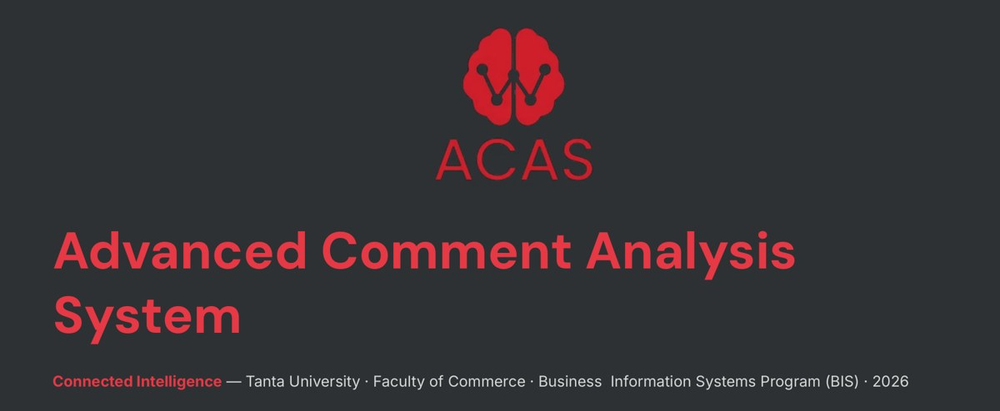
</p>

<p align="center">
  <a href="https://github.com/Ifazawezk/ACAS/actions/workflows/ci.yml"></a>
  
  
  
</p>

<p align="center">
  <b>Listen at scale.</b> ACAS reads customer comments, works out how people feel and what they need,<br>
  and routes urgent issues to the right team before they become crises.
</p>

<p align="center">
  <a href="#-quick-start">Quick start</a> ·
  <a href="#-screenshots">Screenshots</a> ·
  <a href="#-api-overview">API</a> ·
  <a href="advanced_comment_analysis/docs/ACAS-Presentation.pdf">Presentation</a> ·
  <a href="advanced_comment_analysis/docs/ACAS-Project-Report.pdf">Project report</a>
</p>

---

<p align="center">
  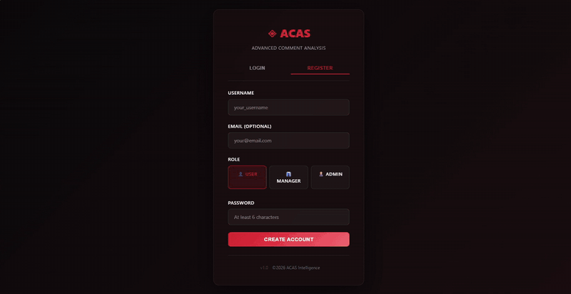
</p>

## 💡 Why ACAS?

Everyone knows how it feels to complain and get no reply. Companies often do care, but they get far more feedback than people can read. Comments pile up across social media, review sites and complaint forms, and real problems get lost.

ACAS started with one teammate who kept losing his luggage on the same airline and never heard back. He built a tool that used AI and web scraping to collect and analyze passenger comments. We then turned it into a general platform that any company in any sector can use.

ACAS uses AI to analyze customer comments. It finds the emotion, intent and priority in each one, suggests a reply, and opens a support ticket routed to the right team when one is needed. It runs **fully offline** with a built-in analyzer and a local SQLite database. Add an OpenAI key to use GPT models, or switch to Postgres for production.

---

## ✨ Features

- **AI comment analysis**: emotion, intent, priority, confidence score and a suggested response
- **Automatic ticket routing** to Support / Tech / Product, using configurable routing rules
- **Dashboard** with live KPIs and history, installable on iPad as a PWA
- **JWT authentication** with role-based access (admin, manager, user)
- **CSV batch import** and export of comments
- **URL scraping** to analyze comments from a web page
- **Response templates**, favorites and an activity/audit log
- **English and Arabic** interface (`frontend/translations`)
- **Offline-first**: works without Docker, Postgres or an API key

## 🧰 Tech stack

| Layer    | Tech                                        |
|----------|---------------------------------------------|
| Backend  | FastAPI, SQLAlchemy, Pydantic, python-jose  |
| AI       | OpenAI API, with a local rule-based fallback |
| Database | SQLite (dev), PostgreSQL (prod)             |
| Frontend | Static HTML/JS dashboard (PWA) and a React + Vite version |
| Ops      | Docker Compose, GitHub Actions              |

---

## 📸 Screenshots

| Live dashboard | Priority triage queue |
|:---:|:---:|
| 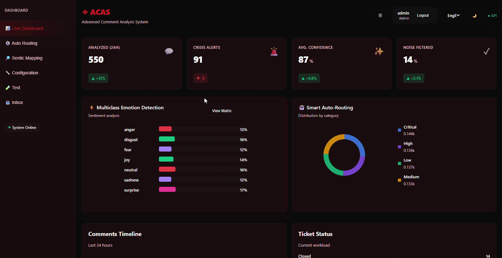 | 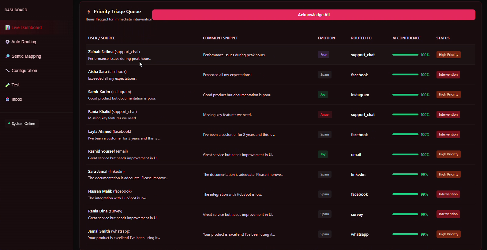 |
| **Comments manager**, with filters by emotion, priority and intent | **Auto routing** to the Support, Tech and Product queues |
| 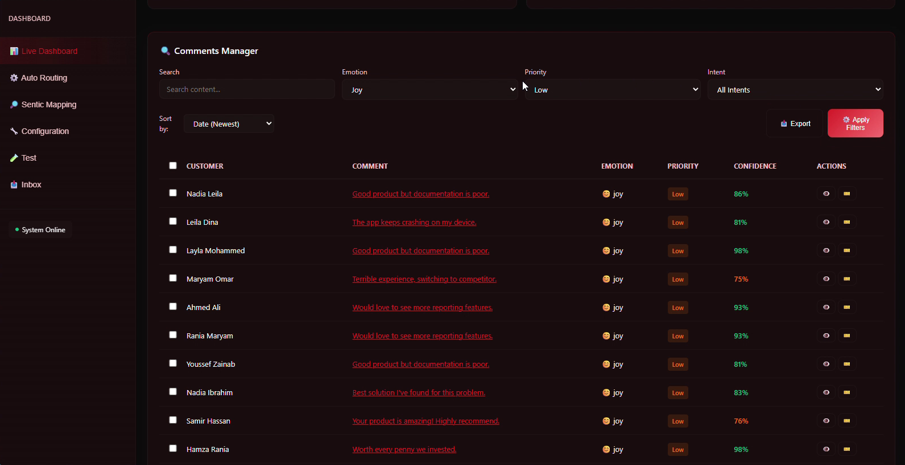 | 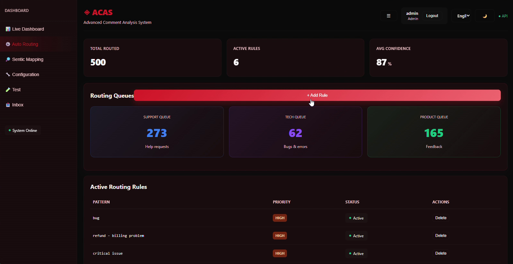 |
| **Test AI analysis** on a single comment, plus URL scraping | **Inbox** of analyzed comments, with one-click ticket creation |
| 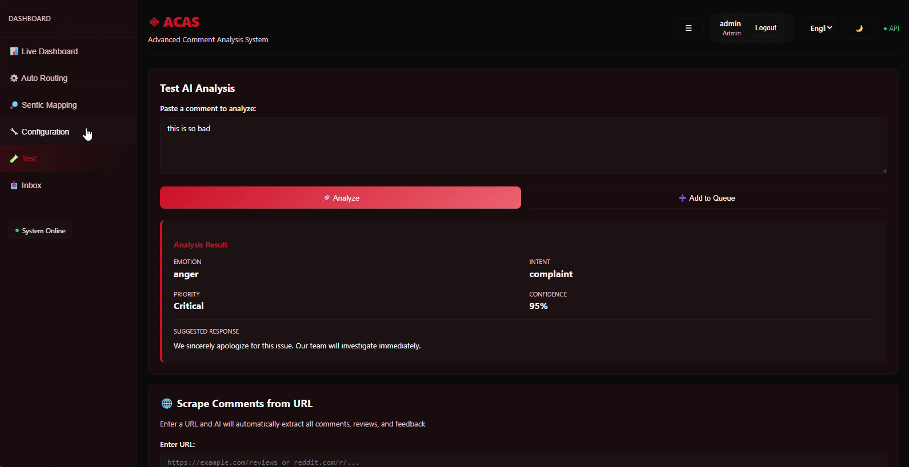 | 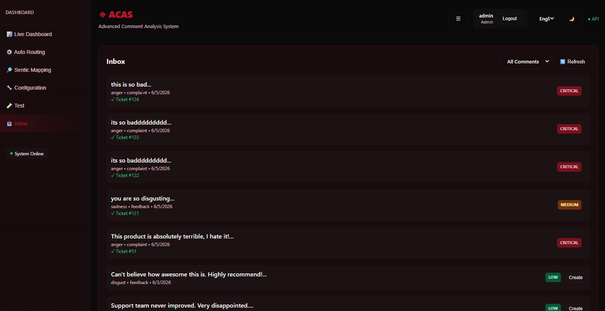 |
| **Sentic mapping**: which emotion maps to which priority | **Configuration**: AI settings and API keys |
| 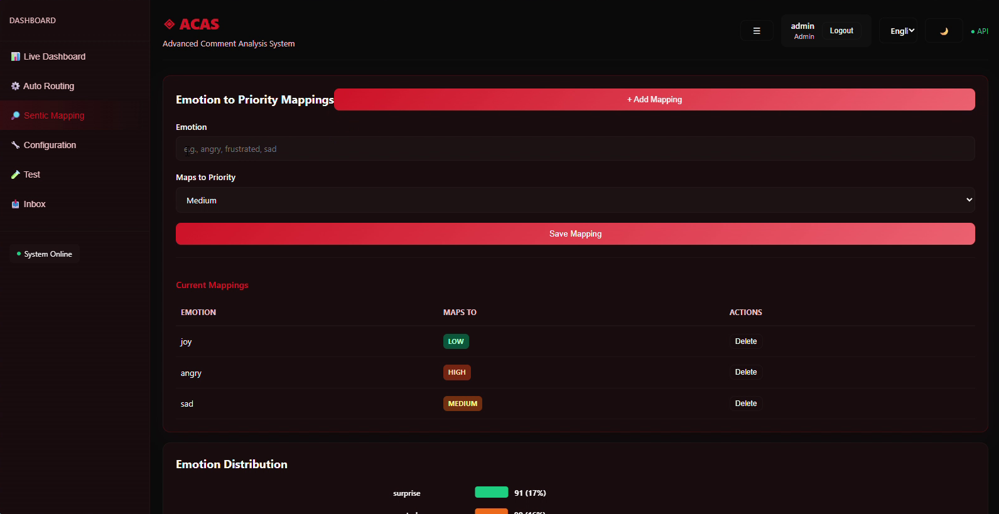 | 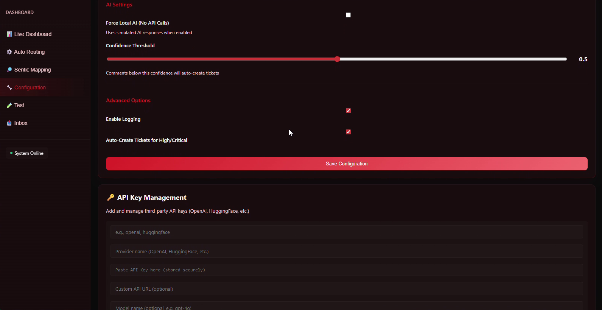 |

<details>
<summary>Login screen</summary>
<br>
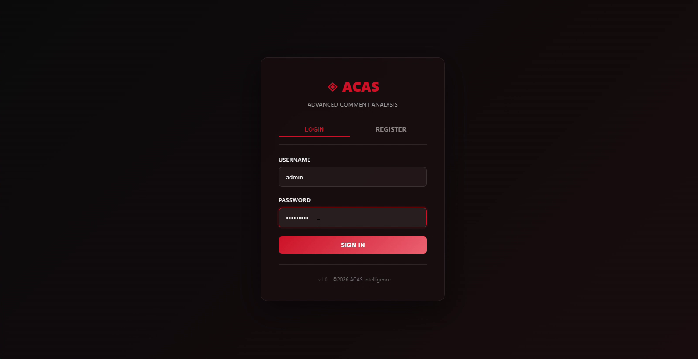
</details>

---

## 🚀 Quick start

> Requires **Python 3.11**. The commands below are for Windows PowerShell.

```powershell
git clone https://github.com/Ifazawezk/ACAS.git
cd ACAS\advanced_comment_analysis

# 1. Configure
Copy-Item .env.example .env        # then edit .env

# 2. Install + run (creates .venv and starts the API on port 8000)
powershell -ExecutionPolicy Bypass -File .\START_HERE.ps1

# 3. (Optional) create the demo users
.\.venv\Scripts\python.exe tools\seed_users.py
```

Then open:

- **Dashboard:** http://127.0.0.1:8000/frontend/static_index.html
- **API docs (Swagger):** http://127.0.0.1:8000/docs
- **Health check:** http://127.0.0.1:8000/health

<details>
<summary>macOS / Linux</summary>

```bash
cd ACAS/advanced_comment_analysis
cp .env.example .env
python3.11 -m venv .venv && source .venv/bin/activate
pip install -r requirements.txt
mkdir -p data
uvicorn app.main:app --reload
```
</details>

### Demo accounts

`tools/seed_users.py` creates these accounts **for local development only**:

| Role    | Username    | Password                        |
|---------|-------------|---------------------------------|
| Admin   | `admin`     | `admin@123`                     |
| User    | `demo_user` | `demo@123`                      |
| Manager | `maha_ebeid`| set by `SEED_MANAGER_PASSWORD` in `.env` |

Change or delete these accounts before you deploy anywhere public.

---

## ⚙️ Configuration

All settings are read from `advanced_comment_analysis/.env`. See [`.env.example`](advanced_comment_analysis/.env.example).

| Variable                  | Default                | Description |
|---------------------------|------------------------|-------------|
| `USE_SQLITE_DEV`          | `true`                 | Use the local SQLite database |
| `DATABASE_URL`            | `sqlite:///data/dev.db`| Database connection string (Postgres in production) |
| `FORCE_LOCAL`             | `false`                | Always use the offline analyzer, even when an API key is set |
| `OPENAI_API_KEY`          | —                      | Turns on OpenAI-powered analysis |
| `OPENAI_MODEL`            | `gpt-4o`               | Model used for analysis |
| `AI_CONFIDENCE_THRESHOLD` | `0.5`                  | Minimum confidence before AI output is trusted |
| `JWT_SECRET_KEY`          | —                      | **Set to a long random value** |
| `JWT_ALGORITHM`           | `HS256`                | JWT signing algorithm |
| `JWT_EXPIRE_MINUTES`      | `60`                   | How long a login token stays valid |

---

## 🔌 API overview

The full interactive reference is at `/docs`. Most endpoints require `Authorization: Bearer <token>`.

| Method | Endpoint | Description |
|--------|----------|-------------|
| `POST` | `/auth/register` | Create an account |
| `POST` | `/auth/token` | Log in (`{"username", "password"}`) → JWT |
| `GET`  | `/auth/me` | Current user |
| `POST` | `/ai/analyze` | Analyze a single comment |
| `POST` | `/ai/scrape-url` | Pull comments from a URL and analyze them |
| `GET` / `POST` | `/comments/` | List / add comments |
| `POST` | `/comments/upload` | CSV batch import |
| `POST` | `/comments/bulk-action` | Bulk update comments |
| `GET`  | `/comments/export/download` | Export comments |
| `GET` / `POST` | `/tickets/` | List / create tickets |
| `POST` | `/tickets/{id}/close` | Close a ticket |
| `GET`  | `/dashboard/metrics` | KPIs for the dashboard |
| `GET`  | `/dashboard/metrics/history` | KPI history |
| `*`    | `/admin/rules`, `/admin/sentics`, `/admin/config`, `/admin/api-configs` | Admin settings |
| `*`    | `/admin/templates`, `/admin/activity-log` | Templates and audit log |

**Example:**

```powershell
$body = @{ comment_text = "This API keeps crashing!" } | ConvertTo-Json
Invoke-RestMethod -Uri http://127.0.0.1:8000/ai/analyze -Method Post `
  -Body $body -ContentType application/json -Headers @{ Authorization = "Bearer $token" }
```

```json
{
  "emotion": "frustration",
  "intent": "support",
  "priority": "High",
  "needs_ticket": true,
  "confidence": 0.94,
  "suggested_response": "We sincerely apologize..."
}
```

---

## 🗂️ Project structure

```
ACAS/
├── .github/workflows/ci.yml      # Runs tests on every push
└── advanced_comment_analysis/
    ├── app/
    │   ├── api/                  # FastAPI routers (auth, ai, comments, tickets, ...)
    │   ├── models/               # SQLAlchemy models
    │   ├── schemas/              # Pydantic request/response schemas
    │   ├── services/             # Business logic (AI, scraping, CSV, auth)
    │   ├── database/             # DB session/engine
    │   ├── utils/                # Security, roles, logging
    │   └── main.py               # App entry point
    ├── frontend/                 # Dashboard (static HTML + React/Vite), PWA assets
    ├── tests/                    # pytest suite
    ├── tools/                    # Seeding, smoke tests, verification scripts
    ├── docs/                     # Guides, screenshots, presentation and report PDFs
    ├── dashboard_app.py          # Optional Streamlit dashboard
    ├── Dockerfile
    ├── docker-compose.yml
    ├── START_HERE.ps1            # One-command local startup
    └── requirements.txt
```

---

## 🧪 Development

```powershell
cd advanced_comment_analysis
.\.venv\Scripts\pip install -r requirements-dev.txt

# Unit tests
.\.venv\Scripts\python -m pytest tests -v

# End-to-end checks against a running server
.\.venv\Scripts\python tools\verify_system.py
```

**Adding an endpoint:** add a schema in `app/schemas/`, logic in `app/services/` and a router in `app/api/`, then register the router in `app/main.py`.

### Docker

This starts Postgres, the API (port 8000) and the Streamlit dashboard (port 8501):

```powershell
cd advanced_comment_analysis
docker compose up --build
```

Set `USE_SQLITE_DEV=false` and point `DATABASE_URL` at Postgres in `.env`.

---

## 📚 Documentation

More guides are in [`advanced_comment_analysis/docs`](advanced_comment_analysis/docs):

- 📊 [Project presentation (PDF)](advanced_comment_analysis/docs/ACAS-Presentation.pdf)
- 📘 [Full project report (PDF)](advanced_comment_analysis/docs/ACAS-Project-Report.pdf): feasibility study, competitor analysis and a walkthrough of every screen
- [Quick reference](advanced_comment_analysis/docs/QUICK_REFERENCE.md)
- [JWT authentication](advanced_comment_analysis/docs/JWT_IMPLEMENTATION.md) and the [migration guide](advanced_comment_analysis/docs/JWT_MIGRATION_GUIDE.md)
- [Installing on iPad](advanced_comment_analysis/docs/IPAD_APP_INSTALLATION.md) and the [deployment options](advanced_comment_analysis/docs/IPAD_DEPLOYMENT_OPTIONS.md)
- [Feature overview](advanced_comment_analysis/docs/FEATURE_COMPLETE.md)

## 🛠️ Troubleshooting

- **Port 8000 in use:** `Stop-Process -Id (Get-NetTCPConnection -LocalPort 8000).OwningProcess -Force`
- **`ModuleNotFoundError`:** activate the venv (`.\.venv\Scripts\Activate.ps1`) and run `pip install -r requirements.txt`
- **Database locked:** stop every running Python/uvicorn process and start again

---

## 🗺️ Roadmap

- [ ] **Human-in-the-loop validation:** moderators audit the AI's emotion detection on critical tickets
- [ ] **Multilingual expansion:** multilingual transformer models (e.g. mBERT) for Arabic, French and Spanish
- [ ] **Voice-to-text:** analyze audio feedback from hotlines and kiosks
- [ ] **Predictive crisis modeling:** spot patterns that come before an operational failure
- [ ] **Cloud scalability:** move to managed PostgreSQL/MongoDB to handle millions of comments

## 🎓 About

ACAS is a graduation project from the **Business Information Systems (BIS) program**, Faculty of Commerce, **Tanta University** (2026).

**Team:** Mohaned Mohamed Abdulhamid Elhagar · Alshimaa Nagah Mohamed Eissa · Malak Ashraf Mohamed Ashoush · Mohamed Ehab Abdulelfattah Abu-Elmagd · Adham Mohamed Elmaraay Elsharkawy

**Supervised by:** Maha Mohamed Abdel Ebeid
