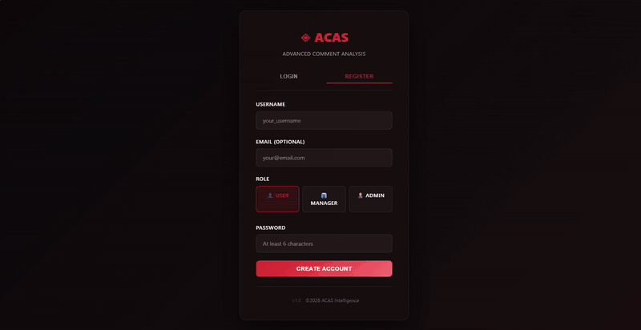
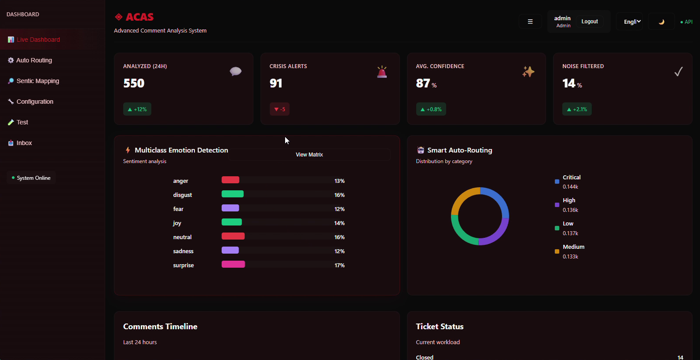
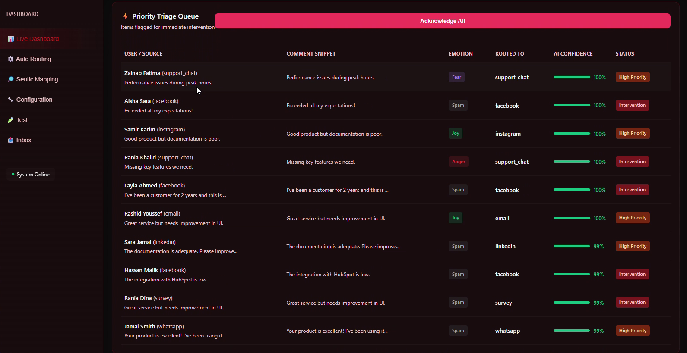
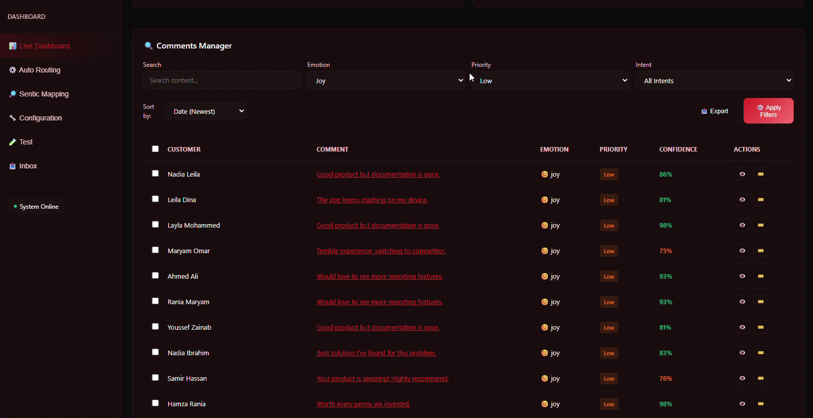
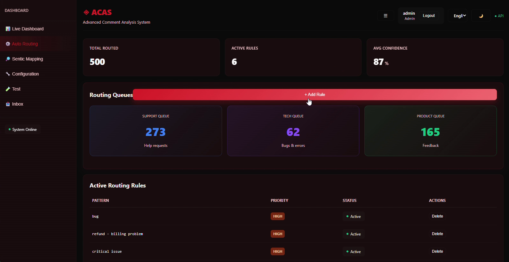
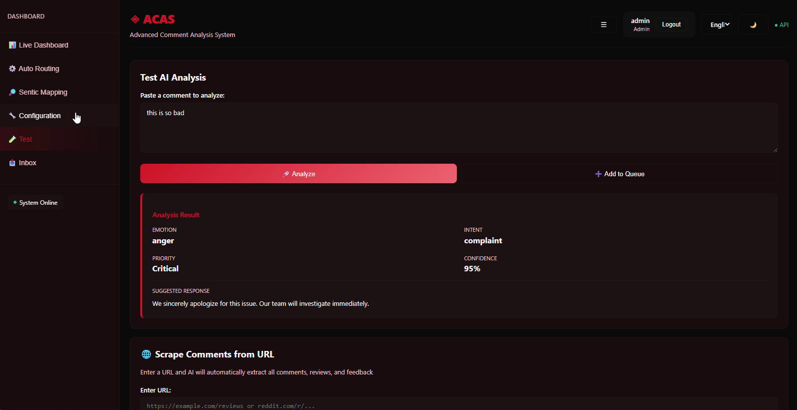
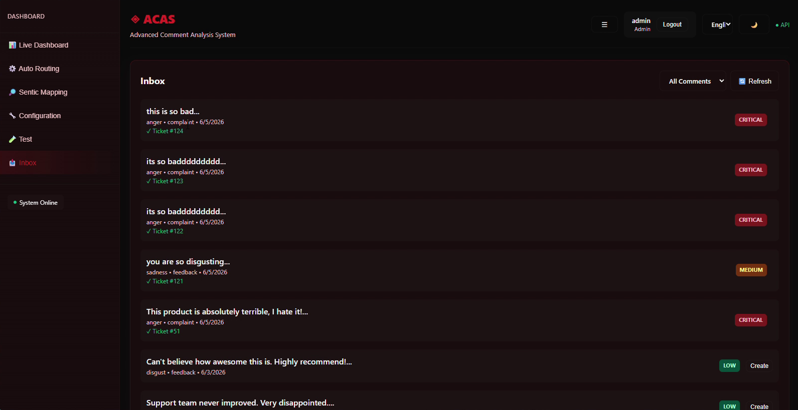
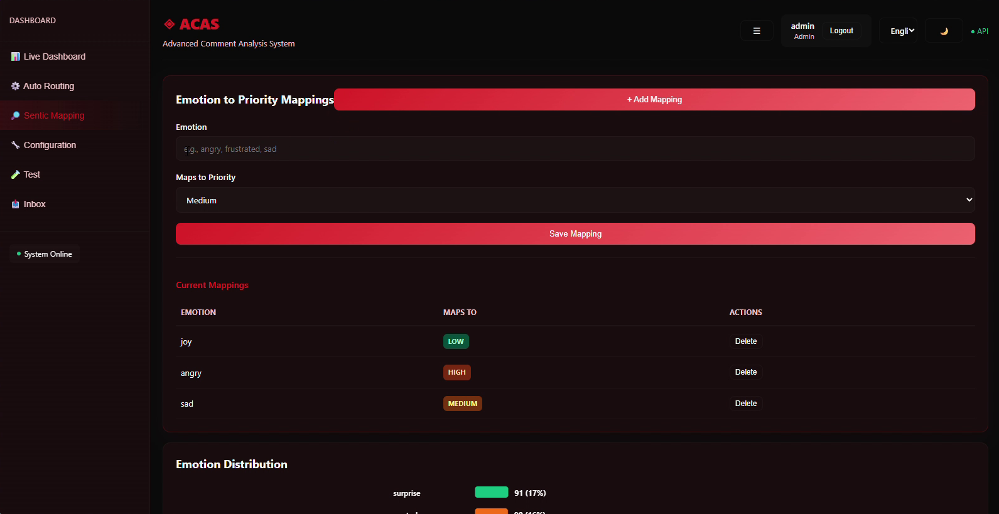
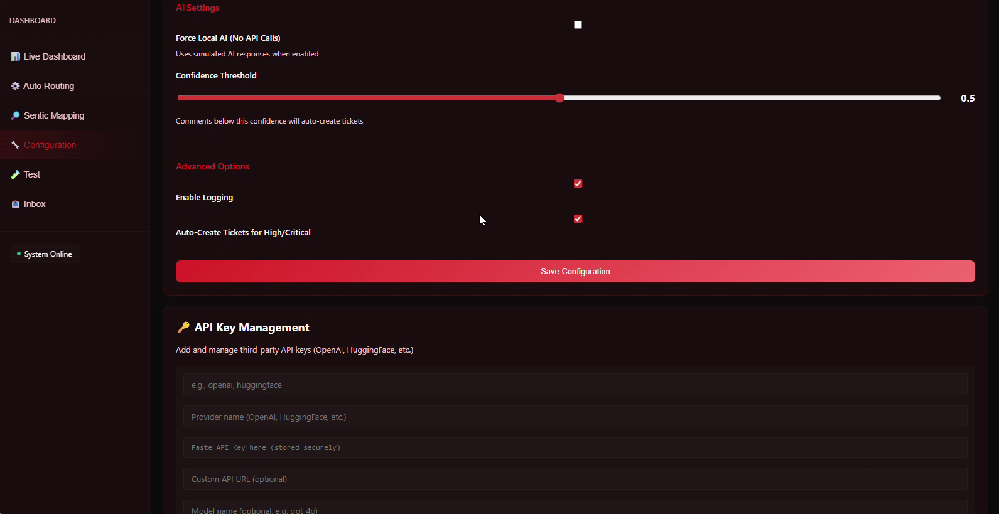
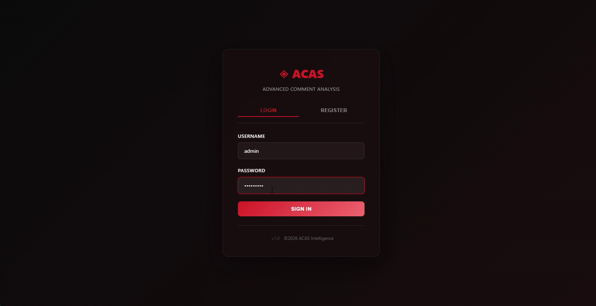

# ACAS

<p>
  <a href="https://github.com/Ifazawezk/ACAS/actions/workflows/ci.yml"></a>
  
  
</p>

ACAS (Advanced Comment Analysis System) reads customer comments in English and Arabic, labels the emotion, intent and priority of each one, suggests a reply, and opens a support ticket for the right team when one is needed. It runs offline with a built-in analyzer and a local SQLite database. Add an OpenAI key to use GPT models, or switch to Postgres for production.



Tickets are routed to the Support, Tech and Product queues by configurable rules. There is also a dashboard with live KPIs and history that installs on an iPad as a PWA, CSV import and export, a scraper that analyzes the comments on a web page, and an English and Arabic interface (`frontend/translations`). Response templates and favorites are only partly built (see [known gaps](#known-gaps)).

The backend is FastAPI, SQLAlchemy, Pydantic and python-jose. The frontend is a static HTML/JS dashboard (PWA) plus a React + Vite version. Analysis uses the OpenAI API with a local rule-based fallback, data lives in SQLite in development and PostgreSQL in production, and Docker Compose and GitHub Actions handle the rest.

<details>
<summary>More screenshots</summary>
<br>

| Live dashboard | Priority triage queue |
|:---:|:---:|
|  |  |
| Comments manager, with filters by emotion, priority and intent | Auto routing to the Support, Tech and Product queues |
|  |  |
| AI analysis of a single comment, plus URL scraping | Inbox of analyzed comments, with one-click ticket creation |
|  |  |
| Sentic mapping: which emotion maps to which priority | Configuration: AI settings and API keys |
|  |  |


</details>

## Running it

You need Python 3.11 or 3.12. These commands are for Windows PowerShell:

```powershell
git clone https://github.com/Ifazawezk/ACAS.git
cd ACAS\advanced_comment_analysis

# 1. Configure
Copy-Item .env.example .env        # then edit .env

# 2. Install + run (creates .venv and starts the API on port 8000)
powershell -ExecutionPolicy Bypass -File .\START_HERE.ps1

# 3. (Optional, local only) create the demo users
.\.venv\Scripts\python.exe tools\seed_users.py
```

The dashboard is at http://127.0.0.1:8000/frontend/static_index.html, the Swagger docs at http://127.0.0.1:8000/docs and a health check at http://127.0.0.1:8000/health.

<details>
<summary>macOS / Linux</summary>

```bash
cd ACAS/advanced_comment_analysis
cp .env.example .env
python3.11 -m venv .venv && source .venv/bin/activate
pip install -r requirements.txt
mkdir -p data
uvicorn app.main:app --reload
```
</details>

### Accounts

`tools/seed_users.py` creates these accounts for local development, and refuses to run when `ENVIRONMENT` is production. If you seeded a database during development, delete them before you use it anywhere public.

| Role    | Username    | Password                        |
|---------|-------------|---------------------------------|
| Admin   | `admin`     | `admin@123`                     |
| User    | `demo_user` | `demo@123`                      |
| Manager | `maha_ebeid`| set by `SEED_MANAGER_PASSWORD` in `.env` |

Anyone who can reach the server can register. Registration always creates a normal `user` and ignores any `role` in the request, so the first admin has to be created by a command on the server:

```powershell
cd advanced_comment_analysis
.\.venv\Scripts\python.exe tools\create_admin.py --username owner --email owner@example.com
```

It asks for a password of at least 12 characters, or reads `ACAS_ADMIN_PASSWORD` when run from a script. There is no password option, because command line arguments end up in shell history. It creates missing tables, so it works on an empty database, and it stops without changing anything if the username is taken. Run it with the same settings as the server so it reaches the same database.

## Configuration

Settings are read from `advanced_comment_analysis/.env`. [`.env.example`](advanced_comment_analysis/.env.example) has all of them.

| Variable                  | Default                | Description |
|---------------------------|------------------------|-------------|
| `ENVIRONMENT`             | `development`          | `development`, `dev`, `local` and `test` are local. Any other value counts as production |
| `USE_SQLITE_DEV`          | `true`                 | Use the local SQLite database |
| `DATABASE_URL`            | `sqlite:///data/dev.db`| Database connection string (Postgres in production) |
| `FORCE_LOCAL`             | `false`                | Always use the offline analyzer, even when an API key is set |
| `OPENAI_API_KEY`          | none                   | Turns on OpenAI analysis |
| `OPENAI_MODEL`            | `gpt-4o`               | Model used for analysis |
| `AI_CONFIDENCE_THRESHOLD` | `0.5`                  | Minimum confidence before AI output is trusted |
| `JWT_SECRET_KEY`          | none                   | At least 32 random characters. Production refuses to start without it. In development a missing or short value is replaced by a random secret, so logins end when the server stops |
| `JWT_ALGORITHM`           | `HS256`                | JWT signing algorithm |
| `JWT_EXPIRE_MINUTES`      | `60`                   | How long a login token stays valid |
| `SCRAPE_ALLOWED_HOSTS`    | empty                  | Host names the URL scraper may fetch even if they are private, separated by commas |
| `ACAS_ADMIN_PASSWORD`     | empty                  | Password for `tools/create_admin.py` when it runs from a script |

Every analysis result has an `analyzer` field, either `openai` or `local`. If the API can't be reached, ACAS falls back to the local analyzer and logs why, so a bad key or an outage shows up as `local`.

## API

`/docs` has the interactive reference. To try protected routes there, log in with `POST /auth/token`, click Authorize and paste the token.

Every endpoint needs `Authorization: Bearer <token>` except `POST /auth/register`, `POST /auth/token`, `GET /health`, the docs pages (`/docs`, `/redoc`, `/openapi.json`) and the static files under `/frontend`. A request with no token gets a 401, and a normal account calling an admin route gets a 403.

| Method | Endpoint | Access | Description |
|--------|----------|--------|-------------|
| `POST` | `/auth/register` | Public | Create a normal account |
| `POST` | `/auth/token` | Public | Log in (`{"username", "password"}`), returns a JWT |
| `GET`  | `/health` | Public | Database and analyzer status |
| `GET`  | `/auth/me` | Login | Current user |
| `POST` | `/ai/analyze` | Login | Analyze a single comment |
| `POST` | `/ai/scrape-url` | Login | Pull comments from a public URL, analyze them and save them |
| `GET` / `POST` | `/comments/` | Login | List / add comments |
| `POST` | `/comments/upload` | Login | CSV batch import |
| `POST` | `/comments/bulk-action` | Admin | Bulk update or delete comments |
| `GET`  | `/comments/export/download` | Admin | Export comments |
| `GET` / `POST` | `/tickets/` | Login | List / create tickets |
| `POST` | `/tickets/{id}/close` | Login | Close a ticket |
| `GET`  | `/dashboard/metrics` | Login | KPIs for the dashboard |
| `GET`  | `/dashboard/metrics/history` | Login | KPI history |
| `*`    | `/admin/rules`, `/admin/sentics`, `/admin/config`, `/admin/api-configs` | Admin | Admin settings |
| `*`    | `/admin/templates`, `/admin/activity-log` | Admin | Templates and activity log |

For example:

```powershell
$body = @{ content = "This API keeps crashing!" } | ConvertTo-Json
Invoke-RestMethod -Uri http://127.0.0.1:8000/ai/analyze -Method Post `
  -Body $body -ContentType application/json -Headers @{ Authorization = "Bearer $token" }
```

```json
{
  "emotion": "anger",
  "intent": "bug_report",
  "priority": "Critical",
  "needs_ticket": true,
  "suggested_response": "We sincerely apologize for this issue. Our team will investigate immediately.",
  "confidence": 0.93,
  "analyzer": "local"
}
```

## Security

`enforce_access` in `app/utils/roles.py` runs on every route. A route needs a login unless it is listed in `PUBLIC_ROUTES`, and anything under `/admin` needs an admin. `tests/test_access.py` walks every route and fails if a non-public one answers without a token. Roles are read from the database on every request, not from the token, so deactivating an account ends its access straight away.

When `ENVIRONMENT` is production, the app won't start unless `JWT_SECRET_KEY` has at least 32 characters. The Docker image sets production and `docker-compose.yml` sets development. The URL scraper refuses this machine and private networks, including through redirects. Uploads are saved under a generated name, and the name the client sends is never used as a path.

### Known gaps

- Anyone who can reach the server can register a normal account, and a normal account can read every comment and ticket. If the comments are private, keep the app behind a VPN or a firewall.
- The `manager` role has no extra rights over `user`.
- Login, registration and uploads have no rate or size limit.
- A token works until it expires. Logging out only removes it from the browser.
- Tokens are kept in the browser's `localStorage`, where a script running on the page could read them. The dashboards escape comment text for this reason.
- API keys saved through `/admin/api-configs` are stored as plain text, and analysis doesn't use them yet. It reads `OPENAI_API_KEY`.
- There is no working audit log. Nothing writes to the activity log, and the routes under `/admin/activity-log` return 500. Saving or reading a template under `/admin/templates` also returns 500, and so does `GET /comments/favorites/list`.
- CSV export leaves a copy of the comments in `/tmp`, and the link it returns doesn't work.
- `docker-compose.yml` is for development. It uses a fixed Postgres password and publishes port 5432.

## Offline analyzer accuracy

The analyzer that runs without an API key was tested on about 13,000 real labelled comments. Its rules were written on a separate development half and frozen before the test half was run. Each cell shows the original analyzer, then the current one.

| Held-out comments | Accuracy | Macro F1 | Tickets opened | Ticket precision | Ticket recall |
|---|---|---|---|---|---|
| English airline tweets (7,145) | 65.0% to 60.8% | 0.392 to 0.571 | 91.5% to 48.0% | 65.9% to 88.4% | 95.8% to 67.4% |
| Arabic product reviews (2,074) | 22.6% to 66.0% | 0.136 to 0.506 | 97.3% to 16.8% | 20.6% to 64.7% | 99.5% to 53.8% |
| Arabic restaurant reviews (4,159) | 29.0% to 69.9% | 0.227 to 0.725 | 99.8% to 33.9% | 28.9% to 55.5% | 99.8% to 65.1% |

A comment labelled negative counts as one that should open a ticket. Precision is the share of opened tickets that were real complaints, and recall is the share of real complaints that got a ticket.

Accuracy went down on the English set and up on both Arabic sets. The original analyzer scored anything it didn't understand as sadness, including all Arabic text, so it opened a ticket for almost every comment, which is why its recall looks high. The current one opens far fewer tickets and most of them are right, but it misses about a third to a half of complaints, because many complaints use no emotional words at all. Accuracy alone says little here: always answering "negative" scores 63.0% on the English set, and always answering "positive" scores 72.9% and 71.1% on the Arabic sets. Macro F1 treats every class equally and is the fairer figure. If a missed complaint is expensive for you, use OpenAI mode or have someone review the comments that get no ticket.

The test leaves some things out:

- Intent, priority and the split between anger and sadness have no labels in this data, so they aren't measured. Neither is OpenAI mode.
- The Arabic labels come from star ratings, not from people reading the reviews, and some are plainly wrong. They are also product and restaurant reviews, so results on real support messages may differ.
- Arabic written in Latin letters (such as "el service wa7sh") is treated as English and won't work well.
- `confidence` is a strength score, not a probability, but higher does mean more often right. On the test half, comments at 0.8 or above were correct 76% (airline), 91% and 92% (Arabic) of the time. Below 0.6 means little was found in the comment, and the Arabic figures there are low (8% to 10%) because those data sets have few neutral comments.

To run it yourself (this downloads about 7 MB into `data/eval`, which git ignores):

```powershell
.\.venv\Scripts\python tools\evaluate_analyzer.py --split test
```

The data isn't stored here because of its licences: [Twitter US Airline Sentiment](https://huggingface.co/datasets/osanseviero/twitter-airline-sentiment) (CC BY-NC-SA 4.0) and the [Arabic review data](https://github.com/hadyelsahar/large-arabic-sentiment-analysis-resouces) from ElSahar and El-Beltagy (2015).

## Development

```powershell
cd advanced_comment_analysis
.\.venv\Scripts\pip install -r requirements-dev.txt

# Unit tests
.\.venv\Scripts\python -m pytest tests -v

# Offline analyzer on real labelled comments (development half)
.\.venv\Scripts\python tools\evaluate_analyzer.py

# End-to-end checks against a running server
.\.venv\Scripts\python tools\verify_system.py
```

To add an endpoint, put a schema in `app/schemas/`, logic in `app/services/` and a router in `app/api/`, then register the router in `app/main.py`. A new route needs a login with no extra code, and an admin if its path starts with `/admin`. To make one public, add it to `PUBLIC_ROUTES` in `app/utils/roles.py` and to the list in `tests/test_access.py`.

```
ACAS/
├── .github/workflows/ci.yml      # Runs tests on every push
└── advanced_comment_analysis/
    ├── app/
    │   ├── api/                  # FastAPI routers (auth, ai, comments, tickets, ...)
    │   ├── models/               # SQLAlchemy models
    │   ├── schemas/              # Pydantic request/response schemas
    │   ├── services/             # Business logic (AI, scraping, CSV, auth)
    │   ├── database/             # DB session/engine
    │   ├── utils/                # Security, roles, logging
    │   └── main.py               # App entry point
    ├── frontend/                 # Dashboard (static HTML + React/Vite), PWA assets
    ├── tests/                    # pytest suite
    ├── tools/                    # Seeding, smoke tests, verification scripts
    ├── docs/                     # Guides, screenshots, presentation and report PDFs
    ├── dashboard_app.py          # Optional Streamlit dashboard
    ├── Dockerfile
    ├── docker-compose.yml
    ├── START_HERE.ps1            # One-command local startup
    └── requirements.txt
```

### Docker

This starts Postgres, the API (port 8000) and the Streamlit dashboard (port 8501):

```powershell
cd advanced_comment_analysis
docker compose up --build
```

Set `USE_SQLITE_DEV=false` and point `DATABASE_URL` at Postgres in `.env`. Compose runs with `ENVIRONMENT=development`, but the image on its own defaults to production, so give it a real `JWT_SECRET_KEY`.

### Troubleshooting

- Port 8000 in use: `Stop-Process -Id (Get-NetTCPConnection -LocalPort 8000).OwningProcess -Force`
- `ModuleNotFoundError`: activate the venv (`.\.venv\Scripts\Activate.ps1`) and run `pip install -r requirements.txt`.
- Database locked: stop every running Python/uvicorn process and start again.
- Logged out after every restart: set `JWT_SECRET_KEY` in `.env` so the server keeps the same secret.

## Docs

[`advanced_comment_analysis/docs`](advanced_comment_analysis/docs) has the [presentation](advanced_comment_analysis/docs/ACAS-Presentation.pdf) and the [project report](advanced_comment_analysis/docs/ACAS-Project-Report.pdf) (feasibility study, competitor analysis and a walkthrough of every screen), both PDF. It also has a [quick reference](advanced_comment_analysis/docs/QUICK_REFERENCE.md), notes on [JWT authentication](advanced_comment_analysis/docs/JWT_IMPLEMENTATION.md) and the [migration guide](advanced_comment_analysis/docs/JWT_MIGRATION_GUIDE.md), [installing on iPad](advanced_comment_analysis/docs/IPAD_APP_INSTALLATION.md) with the [deployment options](advanced_comment_analysis/docs/IPAD_DEPLOYMENT_OPTIONS.md), and a [feature overview](advanced_comment_analysis/docs/FEATURE_COMPLETE.md).

## Roadmap

- [ ] Human review: moderators audit the AI's emotion detection on critical tickets
- [ ] Multilingual transformer models (e.g. mBERT) for Arabic, French and Spanish
- [ ] Voice-to-text for audio feedback from hotlines and kiosks
- [ ] Predictive crisis modeling to spot patterns that come before an operational failure
- [ ] Managed PostgreSQL/MongoDB in the cloud, to handle millions of comments

## About

ACAS is a 2026 graduation project from the Business Information Systems (BIS) program, Faculty of Commerce, Tanta University. It began with a friend who kept losing his luggage on the same airline and never heard back. The first version was a small tool that used AI and web scraping to collect and analyze passenger comments, and it grew into a platform that a company in any sector can use.

Team: Mohaned Mohamed Abdulhamid Elhagar, Alshimaa Nagah Mohamed Eissa, Malak Ashraf Mohamed Ashoush, Mohamed Ehab Abdulelfattah Abu-Elmagd and Adham Mohamed Elmaraay Elsharkawy.

Supervised by Maha Mohamed Abdel Ebeid.
